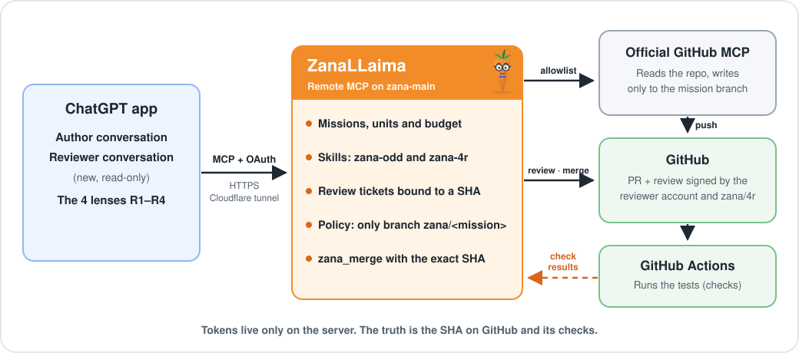
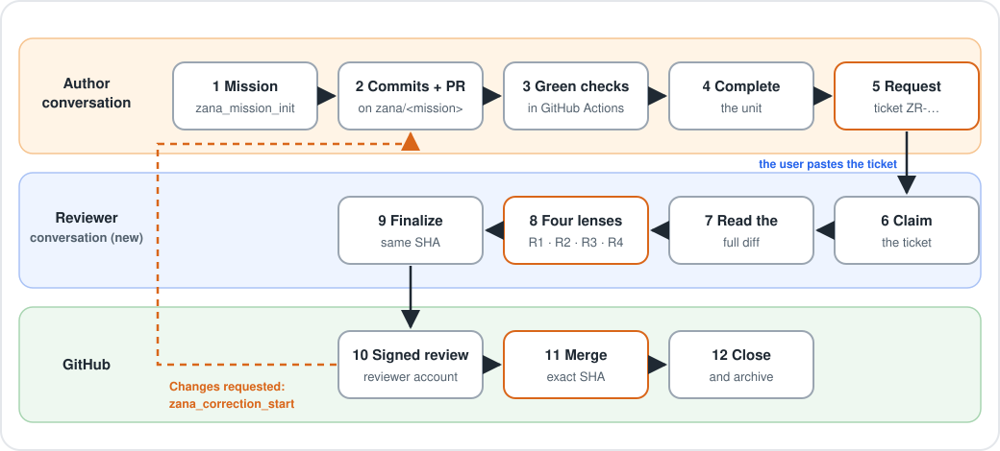

<p align="center">
  
</p>

<h1 align="center">ZanaLLaima</h1>

<p align="center"><b>A development harness for the ChatGPT app.</b><br>
GPT codes, tests and reviews on GitHub with no terminal: a remote MCP sets the rules and GitHub has the final word.</p>

<p align="center">
  <a href="README.md"></a>
  &nbsp;
  <a href="README.en.md"></a>
</p>

---

> **Hi, I'm ZanaLLaima.** I'm a nerdy carrot with glasses, and honestly, I don't trust anything that hasn't gone through my four lenses: risk, readability, reliability and resilience. I don't call any model and I don't have a shell. I just let GPT work where it should, let the tests decide and make the review sign the exact SHA. If anything changes at the last second, I don't merge. 🥕🤓

## What is it?

- **A remote MCP** that plugs into the ChatGPT app as a connector, with OAuth and closed registration. It runs on your own server, behind an HTTPS tunnel (for example Cloudflare Tunnel).
- **A complete harness for a single GPT.** It organizes the mission into units with a budget. GPT writes code **only** on its mission branch (it can also edit and comment on its PR and trigger the checks), the tests run in GitHub Actions, and the 4R review is done by the same GPT in **another conversation**.
- **An honest delivery gate.** The review is published by a GitHub reviewer account (separate from the author) on the exact SHA, and `zana_merge` merges only when everything is green on that same SHA.

## Architecture

<p align="center">
  
</p>

**The truth is the SHA on GitHub and its checks.** The author and reviewer tokens live only on the server: never in the repo, in logs or in tool results.

## How it works

<p align="center">
  
</p>

1. **Author conversation.** GPT loads the `zana-odd` skill and creates the mission (`github: {repo, base}`).
   - While the code unit is `RUNNING`, it writes **only** through `zana_ds_github` and **only** to `zana/<missionId>`.
   - It opens the PR and runs the checks until they are green.
   - Then it **completes the unit**, and only after that requests a ticket with `zana_review_request`. While a code unit is still `RUNNING`, that call returns `UNIT_STILL_RUNNING`.
2. **Reviewer conversation (new).** You paste "Review ticket ZR-… with ZanaLLaima".
   - That session claims the ticket. It cannot be the author, it cannot have written anything and it must be newer than the ticket.
   - It is read-only and reads every page of the diff.
   - It runs the 4 lenses with `zana-4r` and finalizes.
3. **Delivery.** ZanaLLaima re-reads the PR head.
   - If it moved, the result is `STALE_SHA`.
   - Otherwise it publishes the review signed by the reviewer account plus the `zana/4r` status.
   - `zana_merge` merges with `sha` set to the verified head.
   - If the review requested changes, `zana_correction_start` opens a correction unit and the cycle repeats with a new ticket.

## What it guarantees and what it doesn't

| Guarantees | Does not prove |
| --- | --- |
| The reviewer session is not the author, wrote nothing, and reviewed **that** SHA with the full diff and green CI | Which model was used, or that subagents really had a fresh context (the host reports that) |
| GPT cannot write to `main` or `.github/workflows`, or merge through the downstream | That the reviewer is a different ChatGPT account. With `ZANA_DISTINCT_REVIEWER_CLIENT=true` it only proves a different OAuth client; a different account depends on which clients the operator registers |
| A SHA with requested changes cannot be approved again without changing the code | That a server restart won't open a new session in the author conversation (see [docs/solo-rdd.md](docs/solo-rdd.md)) |

## How to set it up

The full guide, from scratch, is in **[docs/deploy-remote.md](docs/deploy-remote.md)** (in Spanish). In short:

1. **Two GitHub accounts.** The author, with a fine-grained token limited to your repos, and a reviewer that only publishes reviews. The exact permissions are in the guide.
2. **Each managed repo** gets the checks workflow ([docs/checks-workflow.md](docs/checks-workflow.md)) and a protected default branch.
3. **A Linux server** with Node.js ≥22.16: clone, `npm ci`, fill in `zanallaima.env` (outside the repo, `chmod 600`) and run it as a `systemd --user` service.
4. **An HTTPS tunnel** (Cloudflare Tunnel or another proxy) that publishes `https://<your-domain>/mcp`.
5. **In ChatGPT**, with developer mode on, create the connector with that URL and OAuth while the enrollment window is open (`node src/cli.mjs remote-enroll 15`).

Your real values (domain, accounts, tokens and operator password) live **only** in the server's environment file. The repo ships none of them as defaults: without `ZANA_PUBLIC_HOST` and `ZANA_REVIEWER_LOGIN` the server does not start.

## Project status

| Component | Status |
| --- | --- |
| Remote mode: HTTP with sessions, OAuth with closed registration, `/health` | Implemented and tested with the official client against local fake servers |
| GitHub MCP downstream and allowlist policy (v2.1.0) | Implemented and tested with a fake MCP; no real contact with `api.githubcopilot.com` |
| Checks, tickets, lenses, review by the reviewer account, delivery and merge | Implemented and tested against a fake GitHub API |
| Real deploy and E2E with the ChatGPT app | **Operator step**, not observed yet |
| SQLite WAL, leases, retries and recovery | Implemented and tested |
| Local stdio mode, `zana_apply_write`, local RDD with `git-evidence`, Ed25519 grants | Implemented; **frozen** after the change of direction |

## Documentation

The detailed documents are in Spanish.

| Topic | Document |
| --- | --- |
| **Step-by-step installation** (accounts, tokens, server, tunnel, connector) | [docs/deploy-remote.md](docs/deploy-remote.md) |
| Tools per mode and transport | [docs/mcp-v2.md](docs/mcp-v2.md) |
| GitHub MCP, policy and the real tool list | [docs/downstream-github.md](docs/downstream-github.md) |
| Checks workflow for managed repos | [docs/checks-workflow.md](docs/checks-workflow.md) |
| Review, tickets and what session separation proves | [docs/solo-rdd.md](docs/solo-rdd.md) |
| Real E2E with the ChatGPT app (ZL-018) | [docs/host-e2e-remote.md](docs/host-e2e-remote.md) |
| Functional safety, states and recovery | [docs/safety-lifecycle.md](docs/safety-lifecycle.md) |
| CI audit, repository security and release | [docs/release-security.md](docs/release-security.md) |
| Roadmap and changelog | [ROADMAP.md](ROADMAP.md) · [CHANGELOG.md](CHANGELOG.md) |

<details>
<summary><b>For developers: requirements, modules and commands</b></summary>

### Requirements

Node.js ≥22.16, Linux for descriptor-anchored write effects, Git, and the dependencies pinned in `package-lock.json`.

```sh
npm ci --ignore-scripts --no-audit --no-fund
npm run check
npm test
npm run release:preflight
```

CI runs on Node 22.16.0, 22.23.4 and 24, with multi-process stress, coverage (≥80 % branches per module) and a dependency audit.

### Modules

- **Remote:**
  - `src/http.mjs`, `src/oauth.mjs`, `src/remote.mjs`: Streamable HTTP with sessions, OAuth with closed registration, and the 29 remote tools.
  - `src/downstream.mjs`, `src/github-policy.mjs`, `src/github-api.mjs`: GitHub MCP gateway, allowlist and REST client with a breaker.
  - `src/checks.mjs`, `src/remote-review.mjs`, `src/github-delivery.mjs`, `src/skills.mjs`: Actions checks, tickets and paged diff, delivery and merge, skills.
  - `src/remote-state.mjs`, `src/remote-config.mjs`, `src/deadline.mjs`, `src/redact.mjs`, `src/actor-assertion.mjs`: sessions, audit and retention, configuration, per-tool deadlines, secret redaction and actor assertion.
- **Core:**
  - `src/core.mjs`, `src/lifecycle.mjs`: unit DAG, claims, heartbeat, expiry and recovery.
  - `src/store.mjs`, `src/budget.mjs`: SQLite WAL, state, attempts, history, receipts and budgets.
- **Local mode (frozen):**
  - `src/mcp.mjs`: the official MCP server in stdio mode.
  - `src/write-effect.mjs`, `src/write-operations.mjs`, `src/review.mjs`, `src/git-evidence.mjs`, `src/delivery.mjs`: write effects, local RDD and the manual gate.

### Local stdio mode (frozen)

```sh
export ZANA_STATE_FILE=/secure/path/zana/state.json
export ZANA_WORKSPACE_ROOT=/absolute/path/to/workspace
export ZANA_REVIEW_REPO=/absolute/path/to/repo
export ZANA_REVIEW_TARGET_REF=refs/heads/main
node src/mcp.mjs
```

In stdio mode the server exposes 24 MCP tools, and `tests/sdk-mcp.test.mjs` checks the catalog against that number. Remote mode exposes 29 (see [docs/mcp-v2.md](docs/mcp-v2.md)). Storage administration (restore, adopt, cleanup) remains operator-only CLI: [docs/sqlite-storage.md](docs/sqlite-storage.md). The guide for the human steps is [docs/operator-checklist.md](docs/operator-checklist.md).

</details>

---

<p align="center"><sub>ZanaLLaima makes no calls to model providers: the connected host brings the model and ZanaLLaima brings the rules. 🥕</sub></p>
