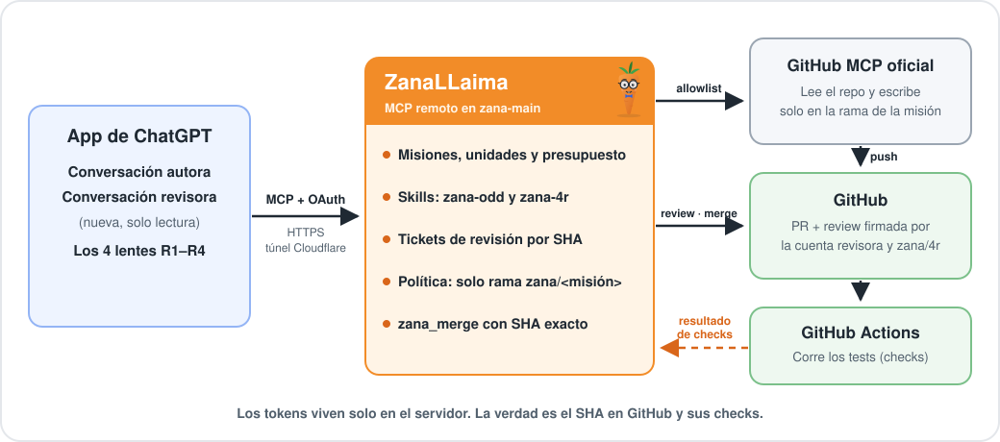
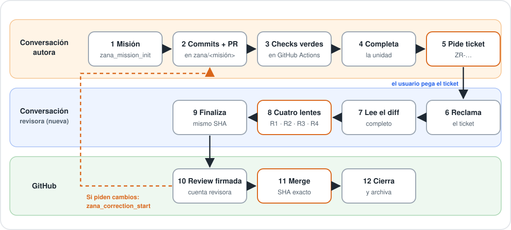

<p align="center">
  
</p>

<h1 align="center">ZanaLLaima</h1>

<p align="center"><b>Harness de desarrollo para la app de ChatGPT.</b><br>
GPT programa, prueba y revisa en GitHub sin terminal: un MCP remoto pone las reglas y GitHub tiene la última palabra.</p>

<p align="center">
  <a href="README.md"></a>
  &nbsp;
  <a href="README.en.md"></a>
</p>

---

> **Hola, soy ZanaLLaima.** Soy una zanahoria nerd con lentes, y la verdad es que no confío en nada que no haya pasado por mis cuatro lentes: riesgo, legibilidad, confiabilidad y resiliencia. No llamo a ningún modelo ni tengo shell. Solo dejo que GPT trabaje donde corresponde, que los tests decidan y que la revisión firme sobre el SHA exacto. Si algo cambia a última hora, no mergeo. 🥕🤓

## ¿Qué es?

- **Un MCP remoto** que se conecta a la app de ChatGPT como conector, con OAuth y registro cerrado. Corre en el servidor del operador (zana-main), detrás de un túnel de Cloudflare.
- **Un harness completo para un solo GPT.** Organiza la misión en unidades con presupuesto. GPT escribe en GitHub **solo** en la rama de su misión, los tests corren en GitHub Actions y la revisión 4R la hace el mismo GPT en **otra conversación**.
- **Un portón de entrega honesto.** La review la publica la cuenta revisora (`sebastianriquelme95-max`) sobre el SHA exacto, y `zana_merge` solo mergea con todo en verde sobre ese mismo SHA.

## Arquitectura

<p align="center">
  
</p>

**La verdad es el SHA en GitHub y sus checks.** Los tokens del autor y de la revisora viven solo en el servidor: nunca en el repo, en logs ni en resultados de tools.

## Cómo se trabaja

<p align="center">
  
</p>

1. **Conversación autora.** GPT carga la skill `zana-odd` y crea la misión (`github: {repo, base}`).
   - Con la unidad de código `RUNNING`, escribe **solo** por `zana_ds_github` y **solo** en `zana/<missionId>`.
   - Abre el PR y corre los checks hasta que queden verdes.
   - **Completa la unidad** y recién entonces pide el ticket con `zana_review_request`. Mientras haya una unidad de código `RUNNING`, responde `UNIT_STILL_RUNNING`.
2. **Conversación revisora (nueva).** Tú pegas "Revisa el ticket ZR-… con ZanaLLaima".
   - Esa sesión reclama el ticket. No puede ser la autora, no puede haber escrito y tiene que ser posterior al ticket.
   - Queda en solo lectura y lee todas las páginas del diff.
   - Corre los 4 lentes con `zana-4r` y finaliza.
3. **Entrega.** ZanaLLaima vuelve a leer el head del PR.
   - Si cambió, responde `STALE_SHA`.
   - Si no, publica la review firmada por la cuenta revisora y el status `zana/4r`.
   - `zana_merge` mergea con `sha` igual al head verificado.
   - Si la review pidió cambios, `zana_correction_start` abre una unidad de corrección y el ciclo se repite con un ticket nuevo.

## Qué garantiza y qué no

| Garantiza | No prueba |
| --- | --- |
| Que la sesión revisora no es la autora, no escribió y revisó **ese** SHA con el diff completo y CI verde | El modelo usado ni que los subagentes hayan tenido contexto realmente fresco (eso lo informa el host) |
| Que GPT no puede escribir en `main`, en `.github/workflows` ni mergear por el downstream | Que la revisora sea otra cuenta de ChatGPT, salvo con `ZANA_DISTINCT_REVIEWER_CLIENT=true` |
| Que un SHA con cambios pedidos no se vuelve a aprobar sin cambiar el código | Que un reinicio del servidor no abra una sesión nueva en la conversación autora (ver [docs/solo-rdd.md](docs/solo-rdd.md)) |

## Estado del proyecto

| Componente | Estado |
| --- | --- |
| Modo remoto: HTTP con sesiones, OAuth con registro cerrado, `/health` | Implementado y probado con el cliente oficial contra servidores falsos locales |
| Downstream GitHub MCP y política allowlist (v2.1.0) | Implementado y probado con un MCP falso; sin contacto real con `api.githubcopilot.com` |
| Checks, tickets, lentes, review con cuenta revisora, delivery y merge | Implementado y probado contra una API de GitHub falsa |
| Deploy en zana-main y E2E real con la app de ChatGPT | **Paso del operador**, todavía sin observar |
| SQLite WAL, leases, reintentos y recuperación | Implementado y probado |
| Modo stdio local, `zana_apply_write`, RDD local con `git-evidence`, grants Ed25519 | Implementado; **congelado** por el cambio de rumbo |

## Documentación

| Tema | Documento |
| --- | --- |
| Deploy en zana-main (lo hace el operador) | [docs/deploy-remote.md](docs/deploy-remote.md) |
| Tools por modo y transporte | [docs/mcp-v2.md](docs/mcp-v2.md) |
| GitHub MCP, política y lista real de tools | [docs/downstream-github.md](docs/downstream-github.md) |
| Workflow de checks para repos administrados | [docs/checks-workflow.md](docs/checks-workflow.md) |
| Revisión, tickets y qué prueba la separación de sesiones | [docs/solo-rdd.md](docs/solo-rdd.md) |
| E2E real con la app de ChatGPT (ZL-018) | [docs/host-e2e-remote.md](docs/host-e2e-remote.md) |
| Roadmap y registro de cambios | [ROADMAP.md](ROADMAP.md) · [CHANGELOG.md](CHANGELOG.md) |

<details>
<summary><b>Para desarrolladores: requisitos, módulos y comandos</b></summary>

### Requisitos

Node.js ≥22.16, Linux para los efectos de escritura anclados a descriptores, Git, y las dependencias fijadas en `package-lock.json`.

```sh
npm ci --ignore-scripts --no-audit --no-fund
npm run check
npm test
npm run release:preflight
```

El CI corre en Node 22.16.0, 22.23.4 y 24, con estrés multiproceso, cobertura (≥80 % de ramas por módulo) y auditoría de dependencias.

### Módulos

- **Remoto:**
  - `src/http.mjs`, `src/oauth.mjs`, `src/remote.mjs`: Streamable HTTP con sesiones, OAuth con registro cerrado y las 29 tools remotas.
  - `src/downstream.mjs`, `src/github-policy.mjs`, `src/github-api.mjs`: gateway del GitHub MCP, allowlist y cliente REST con breaker.
  - `src/checks.mjs`, `src/remote-review.mjs`, `src/github-delivery.mjs`, `src/skills.mjs`: checks en Actions, tickets y diff paginado, entrega y merge, y skills.
  - `src/remote-state.mjs`, `src/remote-config.mjs`, `src/deadline.mjs`, `src/redact.mjs`, `src/actor-assertion.mjs`: sesiones, auditoría y retención, configuración, plazos por tool, redacción de secretos y aserción de actor.
- **Núcleo:**
  - `src/core.mjs`, `src/lifecycle.mjs`: DAG de unidades, claims, heartbeat, vencimiento y recuperación.
  - `src/store.mjs`, `src/budget.mjs`: SQLite WAL, estado, intentos, historial y recibos, y presupuestos.
- **Modo local (congelado):**
  - `src/mcp.mjs`: servidor MCP oficial en modo stdio.
  - `src/write-effect.mjs`, `src/write-operations.mjs`, `src/review.mjs`, `src/git-evidence.mjs`, `src/delivery.mjs`: efectos de escritura, RDD local y gate manual.

### Modo local stdio (congelado)

```sh
export ZANA_STATE_FILE=/ruta/segura/zana/state.json
export ZANA_WORKSPACE_ROOT=/ruta/absoluta/al/workspace
export ZANA_REVIEW_REPO=/ruta/absoluta/al/repo
export ZANA_REVIEW_TARGET_REF=refs/heads/main
node src/mcp.mjs
```

En modo stdio el servidor dispone de **24 herramientas MCP**, y `tests/sdk-mcp.test.mjs` comprueba el catálogo contra esa cifra. El modo remoto expone 29 (ver [docs/mcp-v2.md](docs/mcp-v2.md)). La administración del almacenamiento (restore, adopt, cleanup) sigue siendo solo CLI del operador: [docs/sqlite-storage.md](docs/sqlite-storage.md). La guía de los pasos humanos está en [docs/operator-checklist.md](docs/operator-checklist.md).

</details>

---

<p align="center"><sub>ZanaLLaima no hace llamadas a proveedores de modelos: el host conectado pone el modelo y ZanaLLaima pone las reglas. 🥕</sub></p>
